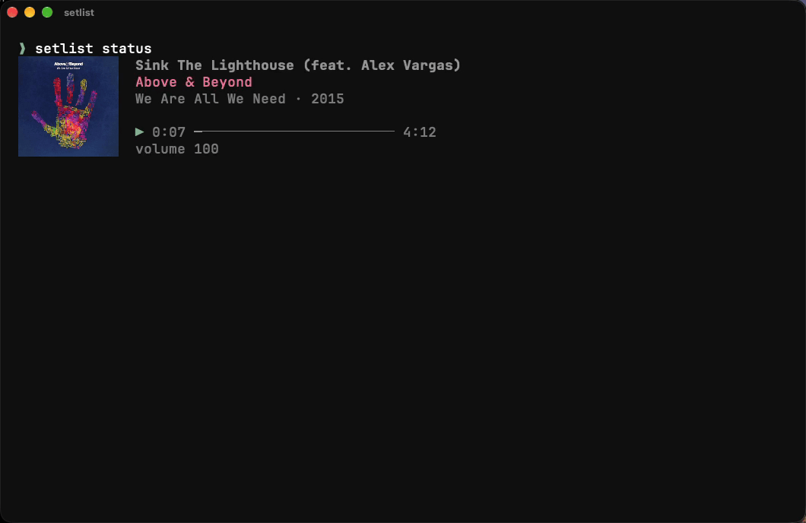

# Setlist

Apple Music from your terminal, for you and your AI agents.



Setlist plays, searches and tidies your Apple Music library from the command
line. Every command prints readable output, or `--json` and `--plain` for
scripts and agents. It is inspired by [Spogo](https://github.com/steipete/spogo),
but for Apple Music.

## Install

Setlist needs macOS, Music.app and [Bun](https://bun.sh).

```bash
git clone https://github.com/proxynico/setlist.git
cd setlist
bun install
bun link
```

`bun run build` makes a single binary at `dist/setlist` instead.

The first command that controls Music.app makes macOS ask whether your terminal
may control Music. Allow it.

## Quick Start

```bash
setlist status                       # what's playing, with album art
setlist search track "frank ocean"
setlist play "white ferrari"
setlist next
setlist seek 60
setlist volume 60
setlist shuffle on
setlist repeat all
setlist library playlists
setlist library audit                # duplicates, orphans, playlist shape
setlist replay 2025                  # your year in music
```

## Album Art

`setlist status` draws the current track's artwork beside it in Ghostty, Kitty,
iTerm2 and WezTerm. Other terminals, tmux, pipes, `--json` and `--plain` get
text only.

## Replay

```bash
setlist replay          # this year so far
setlist replay 2025     # a past year
```

Apple Music Replay, in your terminal: hours listened, how many songs, artists
and genres, your top songs in order, the artists with the most songs among
them, and your hours for every year since you joined. It needs the Apple Music
sign-in described below.

## Use It From an AI Assistant

`setlist mcp` runs an [MCP](https://modelcontextprotocol.io) server, so Claude
Code, Claude Desktop, Cursor and other MCP apps can play music, search, read your
library and tidy playlists. Asked what's playing, an assistant sees the album
art too.

```bash
claude mcp add setlist -- setlist mcp
```

For other apps, add this to their MCP settings:

```json
{
  "mcpServers": {
    "setlist": { "command": "setlist", "args": ["mcp"] }
  }
}
```

It uses the same engines as the command line; `setlist --engine native mcp`
picks one. Reads are marked read-only, and removing tracks from a playlist is
marked destructive.

## For Scripts and Agents

Every command has three output modes:

```bash
setlist status          # readable
setlist status --json   # JSON
setlist status --plain  # tab-separated, for shell pipelines
```

IDs in JSON output say where they came from, so a later command sends them back
to the right place:

| ID | Meaning |
| --- | --- |
| `native:persistent:ABC123` | A Music.app track or playlist |
| `api:library:l.ABC123` | An item in your Apple Music library |
| `api:catalog:1234567` | An item in the Apple Music catalog |
| `native:derived:album:...` | An album or artist grouped from Music.app search results |

Playlist edits (`playlist add` and `playlist remove`) take `native:persistent`
IDs.

## Engines

| Engine | Use it for | Sign-in |
| --- | --- | --- |
| `native` | Music.app playback, your local library, playlist edits, AirPlay devices | None |
| `api` | Apple Music catalog search and cloud library reads | Apple Music web token |
| `auto` | Native for playback, API for catalog and library when signed in | Optional |

`auto` is the default. When you are signed in and an API request fails, Setlist
shows that error rather than quietly falling back to Music.app.

```bash
setlist --engine native status
setlist --engine api search track "new song"
setlist config engine auto          # change the default
setlist config storefront auto      # or a country code such as us or hk
```

## Apple Music Catalog and Cloud Library

Playback needs no sign-in. Catalog search and cloud-library reads need an
Apple Music subscription and the `media-user-token` cookie from a browser signed
in to [music.apple.com](https://music.apple.com):

```bash
setlist auth import --browser safari   # or chrome, firefox
setlist auth token <media-user-token>  # paste it yourself
setlist auth status
setlist auth clear
```

The token is kept in the macOS Keychain under the `setlist` service, not in
config files.

## Library Gardening

Setlist treats your library as a collection to look after, not just a list of
tracks.

```bash
setlist library audit        # the full report
setlist library duplicates   # same song saved more than once
setlist library orphans      # tracks that are in no playlist
setlist library themes       # orphans that fit an existing playlist
```

The audit covers track, album, artist and playlist counts; the largest and
smallest playlists; top genres, artists, decades and years; duplicates; tracks
outside every playlist; and which of those fit a playlist's genre, artists and
era. On a big library, `--max-items 500` gives a quicker first look.

These commands only read. They never delete, move or add anything.

## Commands

```text
Playback:    play [query] | pause | resume | next | prev | seek <seconds> | status
Volume:      volume [0-100]
Modes:       shuffle [on|off] | repeat [off|one|all]
Search:      search track|album|artist|playlist|all <query> [-l limit]
Library:     library tracks|albums|playlists | library playlist <id>
Gardening:   library audit|duplicates|orphans|themes
Replay:      replay [year] [-l limit]
Playlists:   playlist info <id> | playlist add <id> <trackIds...> | playlist remove <id> <trackIds...>
Devices:     devices
Assistants:  mcp
Sign-in:     auth import|token|status|clear
Config:      config status | config engine [native|api|auto] | config storefront [code|auto]
```

Global flags:

```text
--json         JSON output
--plain        Tab-separated output
--no-color     Disable color output
--engine <e>   native | api | auto
-v, --verbose  Show the underlying cause when a command fails
```

## Development

```bash
bun install
bun run check   # Biome, typecheck and tests
bun run build
```

## License

MIT
